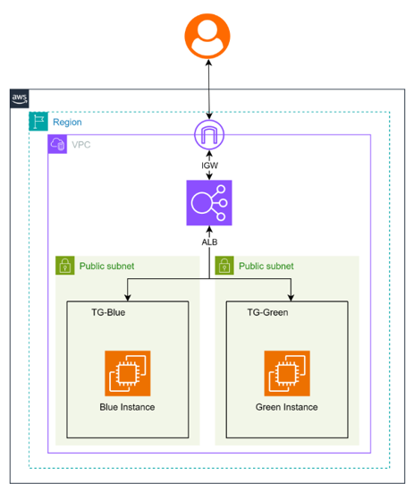
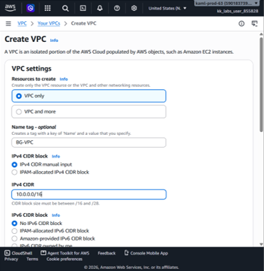
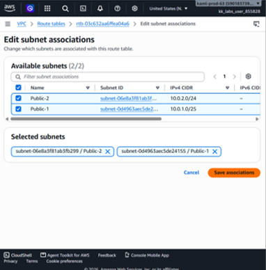
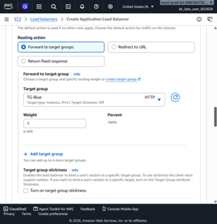
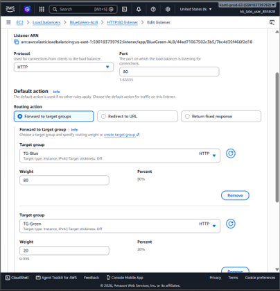

# Zero-Downtime Blue-Green Deployment Architecture on AWS

## 1. Objective
Implement a highly resilient, zero-downtime application delivery network on AWS. This project establishes two identical, fully isolated environments (**Blue** for Version 1 and **Green** for Version 2) managed behind an **AWS Application Load Balancer (ALB)**. 

The system utilizes a **Canary Deployment strategy** to transition user traffic seamlessly, minimizing the blast radius of new updates by routing a controlled percentage of traffic (e.g., 20%) to the new version before executing a full 100% cutover.

---

## 2. Architecture Overview



### Traffic Flow & Canary Strategy
* **Inbound Traffic:** Client requests hit the Internet Gateway (IGW) and are evaluated by the Application Load Balancer (ALB) listening on HTTP Port 80.
* **Canary Routing Rules:** 
  * **Initial State:** 100% of user traffic is directed to the production environment (**TG-Blue**).
  * **Testing/Canary State:** The ALB listener rules are modified to route a weighted split (e.g., **80% to TG-Blue** and **20% to TG-Green**). 
  * **Full Cutover State:** Once Version 2 is verified stable, the listener weight shifts to **100% Green**, routing all users to the new deployment without system downtime.

### Key Design Decisions
* **Isolated Subnets:** Resources reside within dedicated public subnets spanning separate Availability Zones (AZs) to prevent single points of failure.
* **Target Group Segmentation:** Segregating the Blue and Green EC2 instances into distinct target groups allows precise weight-based routing definitions at the load balancer layer.

---

## 3. Resource Summary

| Component | Resource Name | Key Settings / Configurations |
| :--- | :--- | :--- |
| **VPC** | `BG-VPC` | CIDR: `10.0.0.0/16` |
| **Public Subnet 1** | `Public-1` | CIDR: `10.0.1.0/25` \| Availability Zone: `us-east-1a` |
| **Public Subnet 2** | `Public-2` | CIDR: `10.0.2.0/24` \| Availability Zone: `us-east-1b` |
| **Internet Gateway** | `BG-IGW` | Attached to `BG-VPC` for bidirectional internet routing |
| **Route Table** | `BG-RT` | Associated with `Public-1` & `Public-2` \| Default Route: `0.0.0.0/0` -> `BG-IGW` |
| **Security Group** | `Web-SG` | Inbound: SSH (22), HTTP (80) from `0.0.0.0/0` \| Outbound: All |
| **Blue Instance** | `Blue-Server` | Target Subnet: `Public-1` \| User Data: Serves Blue index page (V1) |
| **Green Instance** | `Green-Server` | Target Subnet: `Public-2` \| User Data: Serves Green index page (V2) |
| **Blue Target Group**| `TG-Blue` | Protocol: `HTTP:80` \| Target Type: Instances (`Blue-Server`) |
| **Green Target Group**| `TG-Green` | Protocol: `HTTP:80` \| Target Type: Instances (`Green-Server`) |
| **Load Balancer** | `BlueGreen-ALB` | Type: Application (ALB) \| Internet-facing \| Subnets: `Public-1`, `Public-2` |

---

## 4. Implementation Steps

### Step 1: Network Core Infrastructure (`VPC` & `Subnets`)
1. Create a custom VPC named **BG-VPC** with an IPv4 block of `10.0.0.0/16`.
2. Provision two public subnets in different Availability Zones:
   * **Public-1:** `10.0.1.0/25` in `us-east-1a` (use1-az6).
   * **Public-2:** `10.0.2.0/24` in `us-east-1b` (use1-az1).
3. Enable the **Auto-assign public IPv4 address** setting on both subnets to ensure infrastructure visibility.



### Step 2: Edge Routing (`IGW` & `Route Tables`)
1. Deploy an Internet Gateway named **BG-IGW** and attach it directly to `BG-VPC`.
2. Build a custom route table named **BG-RT**. Add a default target route pointing `0.0.0.0/0` to your `BG-IGW`.
3. Explicitly associate both **Public-1** and **Public-2** subnets to this route table to open public communication paths.



### Step 3: Compute Layer & App Deployments (`EC2`)
1. Launch the **Blue-Server** EC2 instance within `Public-1` using the `Web-SG` security group. Inject the following user data script to configure Apache to output a blue visual layout stating `VERSION 1 (BLUE)`:
   ```bash
   #!/bin/bash
   yum update -y
   yum install -y httpd
   systemctl start httpd
   systemctl enable httpd
   echo "<html><body style='background-color:blue; color:white;'><h1>■ VERSION 1 (BLUE)</h1></body></html>" > /var/www/html/index.html
   ```
2. Launch the **Green-Server** EC2 instance within `Public-2` utilizing identical configuration settings, modifying the script to display a green visual layout stating `VERSION 2 (GREEN)`:
   ```bash
   #!/bin/bash
   yum update -y
   yum install -y httpd
   systemctl start httpd
   systemctl enable httpd
   echo "<html><body style='background-color:green; color:white;'><h1>■ VERSION 2 (GREEN)</h1></body></html>" > /var/www/html/index.html
   ```

### Step 4: Routing Targets & Load Balancer (`ALB`)
1. Provision two individual target groups: **TG-Blue** and **TG-Green** configured over `HTTP:80`. Register `Blue-Server` to the Blue group and `Green-Server` to the Green group respectively.
2. Initialize an internet-facing Application Load Balancer named **BlueGreen-ALB**. Map it across both public availability zones (`us-east-1a` and `us-east-1b`) and bind it to the `Web-SG` firewall rules.
3. Establish a default listener on **HTTP Port 80** configured to forward traffic initially at **100% weight** to `TG-Blue`.



---

## 5. Testing & Canary Verification

### Test 1: Baseline Production Routing (100% Blue)
* **Action:** Request the public DNS address of `BlueGreen-ALB` inside a browser.
* **Result:** The load balancer returns the blue dashboard showing **VERSION 1 (BLUE)** successfully.

### Test 2: Canary Routing Ingestion (80/20 Split)
* **Action:** Update the `BlueGreen-ALB` HTTP:80 default listener routing conditions. Add both target groups and assign an explicit weight allocation metric: **80 to TG-Blue** and **20 to TG-Green**.
* **Result:** Refreshing the application load balancer URL dynamically distributes client sessions. Roughly 4 out of 5 refreshes display the version 1 page, while 1 out of 5 fetches route to **VERSION 2 (GREEN)** seamlessly without dropping connectivity.



### Test 3: Total Application Cutover (100% Green)
* **Action:** Adjust the listener weights cleanly to **0 for TG-Blue** and **1 for TG-Green** (100% allocation).
* **Result:** The production site moves entirely onto the modern stack. Subsequent client queries land securely on the green environment without requiring software release windows or maintenance cycles.
